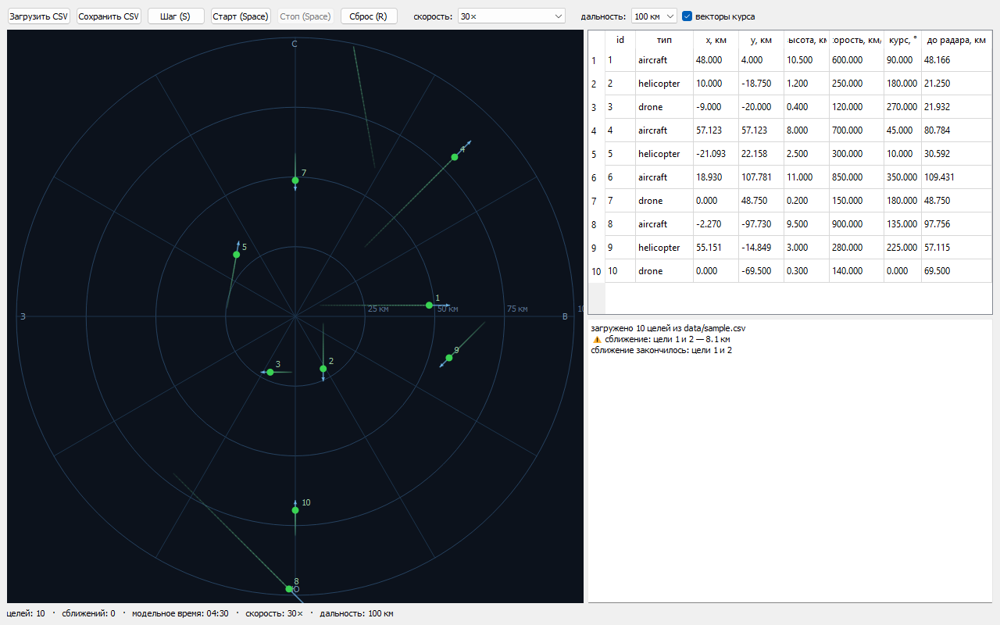
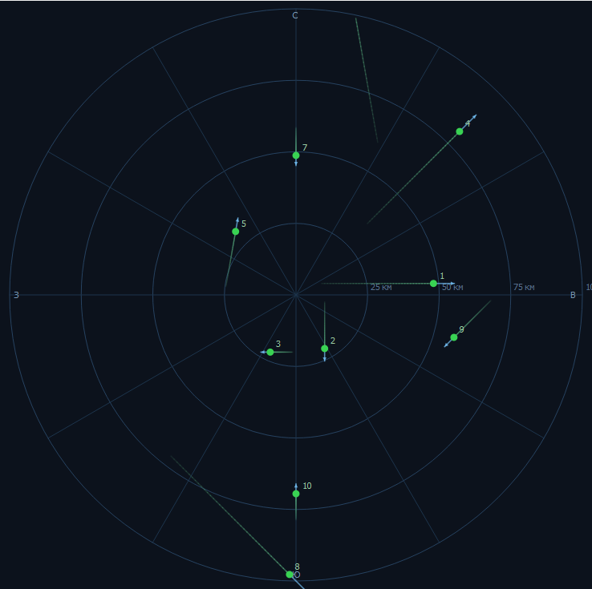

# Трекер воздушной обстановки

   

Учебный проект на C++17: хранит воздушные объекты, двигает их по времени и показывает на индикаторе кругового обзора. Ядро — чистый C++ без Qt, интерфейс — отдельный слой на Qt Widgets, поэтому одни и те же расчёты проверяются в консоли и используются в окне.



## О проекте

Программа изображает работу оператора радиолокационной станции: цели приходят из файла, движутся по своим курсам и скоростям, а оператор видит их на радаре и в таблице, может ускорить время, остановить или сбросить обстановку.

Главная идея — **разделение слоёв**. Вся математика и данные лежат в ядре без единой зависимости от Qt: его собирает и проверяет консоль, его же покрывают тесты. Окно только показывает результаты и передаёт команды. Благодаря этому логику можно отладить без интерфейса, а интерфейс — переписать, не трогая расчёты.

Данные выдуманы, никаких реальных источников. Единицы: километры, км/ч, градусы. Оси в ядре: `x` — на восток, `y` — на север, курс 0° — север, дальше по часовой стрелке.

## Возможности

- **Чтение целей из CSV** с проверкой данных: нет файла — понятная ошибка, битая строка — сообщение с номером строки
- **Сохранение** текущего состояния целей обратно в CSV
- **Геометрия**: расстояние между точками, азимут (с учётом четвертей), нормализация курса в [0, 360)
- **Движение**: цель сдвигается по курсу и скорости за интервал времени, исходная точка не меняется
- **Классы `Target` и `Tracker`**: цель с инвариантом (позицию меняет только `update`), владелец списка с поиском по id
- **Поиск сближений**: пары ближе порога, каждая пара один раз, строгая граница (9.9 км — да, 10.1 — нет)
- **Окно Qt**: таблица целей, радар с кольцами дальности и лучами азимутов, панель лога, строка состояния
- **Ускорение времени** 1×…60×, трассы последних позиций, векторы курса, выбор дальности радара
- **Тесты ядра**: 40 проверок без внешних фреймворков

## Скриншоты

| Радар крупным планом | Что на нём видно |
|---|---|
|  | кольца дальности каждые 25 км, лучи азимутов через 30°, подписи С/В/Ю/З, точки целей с id, стрелки курса (длина растёт со скоростью), трассы последних позиций, красным — сближение целей 1 и 2 |

Скриншоты не рисовались руками: их делает утилита `tools/screenshot.cpp` — она поднимает окно, прокручивает модель на 45 шагов и сохраняет PNG. Включить и запустить:

```
cmake -S . -B build-shot -G Ninja -DAIR_TRACKER_SCREENSHOT=ON -DCMAKE_PREFIX_PATH=C:/Qt/5.15.2/mingw81_64
cmake --build build-shot
cd build-shot && set QT_QPA_PLATFORM=offscreen && screenshot_tool.exe ..\docs
```

## Управление

| Элемент | Действие |
|---|---|
| **Загрузить CSV** | выбрать файл целей (по умолчанию открывается `data/`) |
| **Сохранить CSV** | записать текущее (сдвинутое) состояние целей в файл |
| **Шаг (S)** | один шаг модели: цели сдвигаются на 0,2 с × множитель скорости |
| **Старт (Space)** | включить таймер: 5 шагов в секунду |
| **Стоп (Space)** | остановить таймер, позиции остаются на месте |
| **Сброс (R)** | перечитать файл и вернуть цели в исходные позиции |
| **скорость** | множитель времени: 1×, 2×, 5×, 10×, 30×, 60× (минута модели за секунду) |
| **дальность** | сколько километров помещается в радиус радара: 50 / 100 / 200 / 500 |
| **векторы курса** | показывать стрелки направления; длина стрелки растёт со скоростью |
| **клик по точке** | выделяет цель в таблице |

Красным на радаре отмечаются цели, сблизившиеся ближе 10 км. В лог событие пишется дважды: при появлении сближения и при его прекращении — без повторения каждый тик.

## Быстрый старт

Нужны Qt 5.15.2 с MinGW и CMake (проверялось на Qt 5.15.2 / MinGW 8.1.0 64-bit, CMake 3.30, Ninja).

**Qt Creator:** File → Open File or Project → выбрать `CMakeLists.txt` → Configure Project → кит `Desktop Qt 5.15.2 MinGW 64-bit`. Дальше `Ctrl+B` — сборка, `Ctrl+R` — запуск выбранной цели (`air_tracker_gui`, `console` или `core_tests`), `F5` — отладка.

**Из консоли:**

```
cmake -S . -B build -G Ninja -DCMAKE_PREFIX_PATH=C:/Qt/5.15.2/mingw81_64
cmake --build build

build\air_tracker_gui.exe   :: окно
build\console.exe           :: консольная демонстрация ядра
build\core_tests.exe        :: тесты
```

Если `cmake` не находится, добавьте в `PATH`: `C:\Qt\Tools\CMake_64\bin`, `C:\Qt\Tools\Ninja`, `C:\Qt\Tools\mingw810_64\bin`.

CMake копирует папку `data/` рядом с исполняемыми файлами при сборке, поэтому путь `data/sample.csv` работает и при запуске из каталога сборки. Другой файл можно передать аргументом: `console.exe data\dense.csv`.

## Структура

```
core/                 ядро — чистый C++, без Qt и без вывода
  point.*             точка, расстояние, азимут, нормализация курса, движение
  target.*            цель: состояние + update(dt) + toString()
  tracker.*           список целей: add / remove / findById / updateAll
  io.*                чтение и запись CSV, ошибки с номером строки
  conflict.*          поиск сближений
console/              слой представления для консоли
  main.cpp            демонстрации: геометрия, движение, CSV, прогон, сохранение
  point_print.*       operator<< для Point2D и Target
  console_utf8.h      UTF-8 в консоли Windows
gui/                  интерфейс на Qt Widgets
  mainwindow.*        таблица, кнопки, таймер, лог, скорость, дальность
  radarwidget.*       радар: кольца, азимуты, точки, векторы курса, трассы
tests/test_core.cpp   40 проверок ядра
tools/screenshot.cpp  утилита скриншотов (собирается по флагу)
data/                 sample (10 целей), dense (сближения), edge (границы), bad, empty
```

## Архитектура

```
           файл CSV
              │  loadTargets / saveTargets
              ▼
core:  Point2D ──► Target ──► Tracker ──► findConflicts
              ▲                    │
              │  updateAll(dt)     │  targets() — только чтение
              │                    ▼
console: демонстрация      gui: MainWindow ──► QTableWidget
                                └──► RadarWidget (км → пиксели, инверсия Y)
```

Три правила, на которых держится проект:

1. **Ядро не знает про экран.** Ни `cout`, ни Qt, ни форматирования: только расчёты. Поэтому оно проверяется консолью и тестами.
2. **Время двигает ядро.** Окно сообщает «прошло 0,2 с», переводит в часы и вызывает `updateAll(dt)` — расчёт живёт в одном месте.
3. **Представление только показывает.** Километры переводятся в пиксели внутри `RadarWidget::toScreen`; экранные координаты нигде не хранятся, иначе при изменении размера окна всё поедет.

## Формат данных

```
id,type,x,y,altitude,speed,heading
1,aircraft,3,4,10.5,600,90
```

`id` — целое и уникальное, `type` — `aircraft` | `helicopter` | `drone`, `x`/`y` — км, `altitude` — км, `speed` — км/ч, `heading` — градусы (0° = север).

Наборы для проверки:

| Файл | Что проверяет |
|---|---|
| `sample.csv` | 10 целей; расстояния 5, 10, 20, 25, 28.284, 54.083, 60, 70, 70.711, 80 км; фильтр «ближе 50» → 5 целей |
| `edge.csv` | границы: ровно 50.000 км не проходит, 49.9 проходит, 50.1 нет; отрицательные дробные координаты; курсы 370, −10, 720, 360 |
| `dense.csv` | сближения: пары (1,2) 5 км, (3,4) 8 км, (8,9) 9.9 км и «не конфликт» (10,11) 10.1 км |
| `bad.csv` | текст вместо числа в 4-й строке → `line 4: ожидалось число, получено 'abc'` |
| `empty.csv` | только заголовок → пустой список |

## Тесты

```
build\core_tests.exe
```

40 проверок: расстояние, азимут по четырём направлениям, нормализация курса, движение, `Target`/`Tracker` (включая `findById` → `nullptr`), чтение и запись CSV, границы порога сближения. Код возврата 0 — всё хорошо. Через CTest: `ctest --test-dir build`.

## Что проверено

- сборка всех целей (`core`, `console`, `core_tests`, `air_tracker_gui`) с `-Wall -Wextra` — без предупреждений;
- 40 проверок ядра проходят;
- консольный прогон 60 шагов по 0,2 с: цели двигаются, сближение (1,2) появляется и фиксируется в выводе;
- сохранение и повторная загрузка дают те же 10 целей;
- окно: таблица, радар, кнопки, ускорение времени, трассы, сближения — проверено снимками и ручным запуском.

## Ограничения и что дальше

- порог сближения (10 км) задан в коде — напрашивается поле настройки;
- таблица — `QTableWidget`; следующий шаг — модель/представление (`QAbstractTableModel`) и фильтрация через `QSortFilterProxyModel`;
- трасса ограничена 40 точками и живёт в окне, а не в ядре;
- нет потоков: для десятков целей они и не нужны, но `QThread`/`moveToThread` — тема на будущее;
- интерфейс собран кодом, без Qt Designer — сознательно, чтобы видеть, что происходит.

## Лицензия

Учебный проект, код можно использовать свободно. Данные выдуманы и не относятся к реальным объектам.
